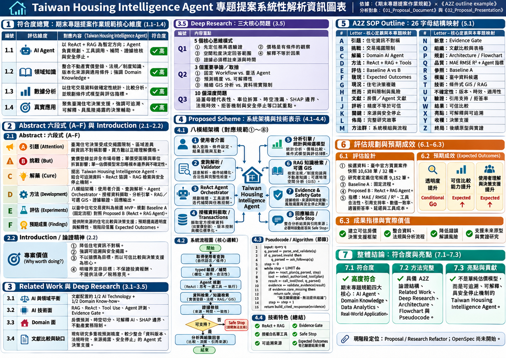

# AIoT DIC3 — Project Proposal Refactor

> NCHU AIoT · 2026-11-11 DIC3 · Research-first, evidence-traceable workflow

本 Repository 用於整理 **Taiwan Housing Intelligence Agent** 的原始 Proposal、AI 輔助研究報告、交叉驗證證據與重構成果。它是課堂 DIC3 的獨立研究工作區，**不是**主程式開發 Repository；不得將本庫的「研究規劃」誤標成主專題已完成的實驗結果。

- 主專題：[Taiwan-Housing-Intelligence-Agent](https://github.com/wupojung/Taiwan-Housing-Intelligence-Agent)
- 老師參考：[2026-11-11-DIC3-ProjectRefactor](https://github.com/huanchen1107/2026-11-11-DIC3-ProjectRefactor)
- 教師要求與本庫執行狀態：以本 README 為入口；具體檔案以 [research/README.md](research/README.md) 為索引。
- AI 工作規則：[agent.md](agent.md)（並由 [AGENTS.md](AGENTS.md) 引導支援該慣例的開發工具）。

## 研究提案資訊圖表（Research Proposal Infographic）

> **狀態：AI 草稿，待研究內容與證據核驗。** 本圖為 A4 橫式高密度 NUMBERING 研究提案視覺化整理，不代表研究結果已完成驗證。詳見 [資訊圖表索引](research/infographic/INDEX.md)。

## 🧠 五大核心設計 (5 Cores)

> **PROPOSED / NOT IMPLEMENTED**：以下是本組研究設計，不是已實作功能。主要依據為 [原始 DESIGN.md](research/originals/DESIGN.md) 與 [TEAM-001 Proposal](research/originals/01_Proposal_Document.pdf)。

1. **Evidence-Grounded Housing Intelligence（證據錨定住宅分析）**：以官方實價登錄交易快照為依據，記錄來源、版本、時間、物件類型、面積與車位口徑。揭露資料不等於全部市場，不能把區域統計當成個別住宅精準估價。**證據：** [DESIGN §2–§3、§11](research/originals/DESIGN.md)。
2. **Bounded ReAct Agent Orchestration（有界代理人調度）**：暫定 ReAct + RAG；Agent 解析查詢、澄清歧義，選擇白名單工具並依 Observation 決定下一步。Owner 方向尚非 Accepted ADR，系統未實作。**證據：** [DESIGN §6–§9、§15](research/originals/DESIGN.md)。
3. **Deterministic Analytics and Explainability（確定性分析與解釋）**：統計、面積換算與比較由可重現的程式工具完成，LLM 不自行計算房價；候選 ML 須先確認資料品質及適用域，SHAP 歸因不等於因果推論。**證據：** [DESIGN §4、§9、§11、§13](research/originals/DESIGN.md)。
4. **Versioned Domain Knowledge and Spatial Context（版本化知識與空間脈絡）**：RAG 保留法規、制度與官方說明的權威來源、發布／生效日期、管轄及適用條件；GIS 為條件式選配。**證據：** [DESIGN §4、§10、§14](research/originals/DESIGN.md)。
5. **Evidence Validation and Safe Failure（證據檢核與安全停止）**：核查 Schema、單位、來源、時效和適用性；隔離無效結果、允許有證據支持的降級回答，核心交易證據不足時停止價格主張。**證據：** [DESIGN §5、§8、§12](research/originals/DESIGN.md)。

## ⚖️ 三大設計權衡 (3 Trade-offs)

1. **Fixed Workflow vs. Dynamic Agent（固定流程 vs. 動態 Agent）**
   - **問題：** 固定流程易於重現且成本可控；動態 Agent 處理複合問題較有彈性，但增加延遲、工具成本與不確定性。
   - **提案策略：** 在同樣資料與任務下比較 Baseline A（固定流程）與 Proposed B（ReAct + RAG）；觀察任務完成、引用支持、工具合法性、延遲與成本。**尚無實驗勝負結論**。
   - **證據：** [DESIGN §6、§12–§13](research/originals/DESIGN.md)。
2. **Prediction Accuracy vs. Interpretability（預測精度 vs. 可解釋性）**
   - **問題：** 複雜模型可能降低誤差，但不易說明；簡單統計基準較易追溯，未必涵蓋屬性異質性。
   - **提案策略：** 先做描述性交易比較；條件允許才評估 ML，使用 MAE、RMSE、R²、子群誤差與解釋分析，避免把模型歸因視為因果。
   - **證據：** [DESIGN §11、§13、§15](research/originals/DESIGN.md)。
3. **Fine-Grained GIS vs. Data Reliability（精細 GIS vs. 資料可靠度）**
   - **問題：** 更細的空間尺度可能提供更多資訊，但模糊地址、樣本不足及去識別化會限制可靠推論。
   - **提案策略：** GIS 僅在來源授權、位置精度、樣本規模足夠時啟用，否則降級至可支持的聚合尺度並揭露限制。
   - **證據：** [DESIGN §4、§9、§14–§15](research/originals/DESIGN.md)。

## 🔬 十大技術細節 (10 Technical Details)

> **PROPOSED TECHNICAL SPECIFICATIONS**：十項技術契約與後續 OpenSpec 候選規格；不得將提案設計誤寫成已完成程式或驗證。

1. **Typed Query Parsing（結構化查詢）**：將自然語言解析為地區、期間與物件型態等 typed 欄位，缺漏時補問，草案最多 2 輪。**證據：** [DESIGN §4–§5、§7](research/originals/DESIGN.md)。
2. **Bounded ReAct Loop（有界推理）**：Thought–Action–Observation 與停止條件；NotebookLM 記載草案上限為 6 步，須於正式規格核對。**證據：** [DESIGN §6、§8](research/originals/DESIGN.md)、[NBLM-001 §3.5（AI 衍生未驗證）](research/notebooklm/01_Proposal_Document_Analysis.md)。
3. **Authorized Read-Only Tool Contracts（授權唯讀工具）**：定義輸入、輸出、Schema 與白名單，越權操作執行前拒絕。**證據：** [DESIGN §5、§9、§12](research/originals/DESIGN.md)。
4. **Transaction Snapshot and Provenance（交易快照溯源）**：追蹤版本、欄位及來源。臺中單一快照已盤點 10,638 筆、32 欄，住宅候選 9,152 筆，僅達 CONDITIONAL GO；日期欄業務語義待核實，並非已完成 ML 實驗。**證據：** [DESIGN §3、§15](research/originals/DESIGN.md)。
5. **Price / Area Normalization（價格與面積口徑）**：總價、單價、移轉面積與車位拆算必須具有明確且一致的計算定義。**證據：** [DESIGN §2、§11](research/originals/DESIGN.md)。
6. **Deterministic Statistical Engine（確定性統計引擎）**：由程式計算樣本數、分布與區域／期間比較，輸出單位、樣本範圍及來源；LLM 不可猜價。**證據：** [DESIGN §4、§9、§11](research/originals/DESIGN.md)。
7. **Temporal / Spatial Holdout（時間與空間留出）**：若執行監督式 ML，先選符合推論情境的時間留出，空間留出取決於資料粒度及樣本數。**證據：** [DESIGN §13、§15](research/originals/DESIGN.md)。
8. **Version-Aware RAG（版本感知知識檢索）**：保存權威來源、發布／生效日期、管轄、適用條件，區分法規事實、交易證據、專家意見與研究假設。**證據：** [DESIGN §6、§10](research/originals/DESIGN.md)。
9. **Evidence Gate / Retry / Safe Stop（證據守門及停止）**：核對來源、Schema、單位及時效，暫時性錯誤草案僅重試一次；核心交易證據全失效則不得提出價格主張。**證據：** [DESIGN §5、§8、§12](research/originals/DESIGN.md)。
10. **Baseline & Agent Reliability Evaluation（基準與可靠性評估）**：規劃固定流程對照 ReAct + RAG，檢測工具合法性、引用支持率、數值一致率、適當拒答率、延遲與成本；房價模型誤差另行評估。**證據：** [DESIGN §13](research/originals/DESIGN.md)、[NBLM-001 §2.5（AI 衍生未驗證）](research/notebooklm/01_Proposal_Document_Analysis.md)。

**證據等級：** [DESIGN.md](research/originals/DESIGN.md) 屬原始設計文件，可支持「規劃內容」；[NotebookLM 解析](research/notebooklm/01_Proposal_Document_Analysis.md) 屬 AI 衍生分析，尚未獨立核實。實際程式、測試與 OpenSpec 工作流的完成狀態須另行驗證。

---

## 01. Teacher's DIC3 requirements（老師原文）

1. **install openspec and be familiar with spec-driven development**
2. **make clear of your project A to F (abstract) 5 cores, 3 trade-off and 10 details**
3. **convert design.md to workflow in openspec**
4. **Introduction refactor**
5. **related work refactor**

以上五項按課堂公告原文保存；是否有追加期限、繳交格式，須另外以老師的正式公告或可核對錄音確認，勿自行推定。

課堂另有示範提示詞：**「請分析內容 做成 資訊圖表 A4 橫式 高密度 NUMBERING」**。本庫將此列為目前第 2 項的**視覺化產出**，保留和五項公告要求的區分。

## 02. Current checkpoint（2026-11-13）

| Item | State | Notes |
| --- | --- | --- |
| 1. OpenSpec 安裝與 SDD | NOT STARTED | 尚未安裝，先記錄要求 |
| 2. A–F / 5 cores / 3 trade-offs / 10 details | DRAFT DOCUMENTED — REVIEW PENDING | 5 Cores、3 Trade-offs、10 Details 已整理並附設計證據；A–F 及學術查證仍待研究重構 |
| 2a. A4 landscape high-density numbered infographic | AI DRAFT — REVIEW PENDING | INFO-001 已由 PR #2 合併進 `main`；圖表內容與文字尚待驗證，不是最終驗收版本 |
| 3. DESIGN.md → OpenSpec workflow | NOT STARTED | 等 1 及設計基線確認後 |
| 4. Introduction refactor | NOT STARTED | 需要可查證證據 |
| 5. Related work refactor | NOT STARTED | 需要 DOI / 全文證據檢核 |
| 原始檔與研究材料匯入 | ARCHIVED — AI REVIEW PENDING | TEAM、TCH、NBLM、INFO 七份素材已由 PR #1～#4 收錄 `main`；AI 衍生材料尚未獨立核驗。詳見 [研究總索引](research/README.md) |

**目前工作焦點：資料盤點、分類、來源紀錄與 Research Refactor 的準備。** 表格狀態僅描述本 Repository，不代表原主專題的實作進度。

## 03. Repository map

| Location | Purpose |
| --- | --- |
| [research/originals/](research/originals/INDEX.md) | 原始來源：你上傳的原始 PDF、PPTX、DOCX、課程材料；只新增、不覆寫 |
| [research/notebooklm/](research/notebooklm/INDEX.md) | NotebookLM 產出的分析、摘要與引用，標記為 AI 衍生材料 |
| [research/perplexity/](research/perplexity/INDEX.md) | Perplexity 輸出、提示詞、修改歷程及執行限制紀錄 |
| [research/cross-validation/](research/cross-validation/INDEX.md) | 多來源交叉比對、主張核對與差異裁定 |
| [research/refactor/](research/refactor/INDEX.md) | 經整理的 A–F、Introduction、Related Work 與研究修訂 |
| [research/infographic/](research/infographic/INDEX.md) | A4 橫式高密度 NUMBERING 圖表與可編輯來源 |
| [papers/](papers/INDEX.md) | 文獻 metadata、DOI 索引與 BibTeX；不收未授權的論文全文 |
| [research/README.md](research/README.md) | 研究檔案索引與各產出狀態 |

## 04. Evidence and publication rules

- **Original / AI-derived / Verified / Final** 是不同角色，不等同於「品質高低」；不可用檔名推測其真實性。
- 原始檔保留原檔名與位元組；若內容改動，另存新版本、建立來源連結與 SHA-256；不要覆寫。
- 每筆研究資產至少記錄：`Asset ID`、檔名/路徑、類別、來源、產生日期（未知時標記 UNKNOWN）、基於哪些輸入、驗證狀態、是否可公開。
- 「已找到 DOI」不代表「全文已讀」或「該論文支持某主張」；不同查核層次需分開記錄。
- 本 Repository **目前公開**。禁止上傳無公開再散布權的付費論文 PDF、個資、憑證或不允許公開的素材。學校授權下載不等同於 GitHub 公開散布授權。
- PDF、簡報與其他二進位檔案如需 LFS，先檢查大小與 `.gitattributes`；LFS 不處理著作權問題。
- 暫不將 AI 草稿自動升級為正式研究結論；實驗尚未驗證者只能標示 `Expected Outcomes`。

## 05. Collaboration

研究原始資料先由 Owner 匯入；AI 整理與查核採可追溯增量工作。重要變更透過 GitHub Issue / PR 留下說明，合併原則為 **Squash Merge**；不得因要求進度而省略證據紀錄。這個庫不自動啟動 OpenSpec 或對主專題進行寫入。

## 06. Intake status

Proposal 原件已由 PR #1 合併進 `main`；NotebookLM 分析與 AI 資訊圖表已由 PR #2 合併進 `main`，AI 內容仍未獨立核驗。Owner 已確認授課教師允許公開本次 DIC3 兩份參考 PDF，並已由 [PR #3](https://github.com/wupojung/AIoT-DIC3-ProjectRefactor/pull/3) 合併至 `main`（索引同步於 PR #4 完成）。所有 AI 衍生內容、驗證結果與正式採納狀態分開記錄於各 [研究索引](research/README.md)。
