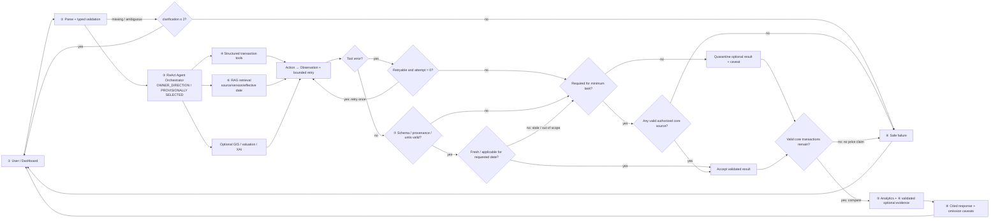

# DESIGN｜Taiwan Housing Intelligence Agent

**狀態：** `PROPOSED / DRAFT`; Owner 於 2026-11-10 指示暫採 ReAct + RAG（`OWNER_DIRECTION / PROVISIONALLY SELECTED`），系統尚未實作、未完成效能驗證、未選定框架，亦未建立 Accepted ADR。研究結果與模型實驗均非本稿已完成工作。本文可獨立閱讀整體系統概念；詳細流程與規格唯一權威為 [`docs/proposal/PROPOSED-SCHEME.md`](docs/proposal/PROPOSED-SCHEME.md)，評估規格見 [`EVALUATION-PLAN.md`](docs/proposal/EVALUATION-PLAN.md)。教師正式要求以 [Issue #2](https://github.com/wupojung/Taiwan-Housing-Intelligence-Agent/issues/2) 為準。

## 1. Project Overview

本專題研究一套面向臺灣住宅資訊比較的 AI Agent 系統，整合可核實的交易資料、確定性分析、條件式 GIS、可追溯 Domain Knowledge 與 Web Dashboard。目標是讓住宅買方理解比較所依據的資料、方法及限制；不以發明 Planner 演算法為主要目標，也不承諾交易結果。

## 2. Problem Statement

公開成交紀錄不是全市場母體。房屋型態、移轉面積與車位處理會影響價格比較；來源時間、欄位及空間精度也限制分析解讀。[MOI transaction data FAQ](https://lvr.land.moi.gov.tw/jsp/qa.jsp) 系統需把每個可查數字連至資料版本與計算方式，遇到缺資料、過期規則、來源衝突或模型範圍外輸入時，清楚補問、降級或停止。

## 3. Target Users and Use Cases

**Preferred MVP candidate — `PREFERRED_CANDIDATE / PENDING_OWNER_APPROVAL`:** 臺中市住宅交易資料比較。RQ-002 已檢視臺中官方單一快照（10,638 筆、32 欄；研究者定義住宅候選 9,152 筆），基本 Schema／品質盤點結果為 `CONDITIONAL GO`。此快照不核准正式研究地區或中古屋範圍；日期欄業務語義、歷史涵蓋、正式納排規則及模型 target 仍待確認。若資料可行性不足，可由 Owner 考慮其他窄化情境；不得自行替換研究範圍。

主要使用情境是區域／物件條件比較與了解資料限制。Agent 提供資訊，不提供個人化法律、稅務、貸款或投資建議。高資產情境不屬於此候選 MVP。

## 4. Functional Requirements (PROPOSED)

- FR-1 接收住宅比較問題，解析地區、期間、物件型態及比較條件；必要時補問。
- FR-2 僅查詢授權與 schema 已核實的來源，輸出來源、快照版本與日期。
- FR-3 以確定性工具計算交易樣本統計；候選價格模型只有通過適用域檢核才可顯示。
- FR-4 GIS 為選配，僅在位置精度、資料品質及使用權利允許時提供。
- FR-5 檢索有版本、有效日、管轄與適用條件的領域證據。
- FR-6 組裝可追溯回答，揭露不確定性、來源限制及缺漏；不可支持時安全停止。
- FR-7 以 Web Dashboard 呈現比較、引用與失敗／降級狀態。

## 5. Non-functional Requirements (PROPOSED)

- **Traceability:** 每項數值或規則主張可追溯來源、版本、時間與計算／模型。
- **Safety:** 白名單、唯讀 typed tools；不得由 LLM 自行計算房價、距離或稅額。
- **Reliability:** 補問最多 2 輪；僅可重試的暫時性工具錯誤重試 1 次；錯誤必須可見。
- **Reproducibility:** 保存資料快照、模型／規則版本、請求 ID 及可用執行設定。
- **Privacy / scope:** 不推定未提供的身份、收入、資產或家庭資料；位置精度採必要最小化。
- **Maintainability:** 來源與架構元件保持可替換，未經審查不強制特定框架或 GIS 產品。

## 6. Proposed Agent Architecture

Owner 暫定 Agent 採用 **ReAct + RAG**（`OWNER_DIRECTION / PROVISIONALLY SELECTED`）。ReAct Orchestrator 以 Thought／Action／Observation 有界迴圈理解查詢、呼叫白名單工具並依 Observation 選擇下一步；RAG 檢索官方資料說明、制度、法規及領域文件，保留來源、版本、有效日期與適用條件。架構尚未實作，未完成延遲／可靠性驗證，未選 LangChain、LangGraph、Dify 或其他實作框架，且此方向不是 Accepted ADR。

## 7. Numbered System Components

1. **① User / Dashboard** — 提交條件並閱讀結果。
2. **② Query Parser / Validator** — 解析並檢查 typed query、必填資訊及歧義。
3. **③ ReAct Agent Orchestrator** — 以 Thought／Action／Observation 有界迴圈選擇白名單工具，依結果採取下一步或安全停止；Owner 暫定選型，非已實作。
4. **④ Authorized Data Retrieval** — 只讀取得核准資料與 provenance。
5. **⑤ Analytics / Candidate ML** — 確定性統計與適用域合格的條件式模型。
6. **⑥ RAG Knowledge Retrieval / Optional GIS** — RAG 檢索帶來源及版本日期的領域文件；GIS 選配。
7. **⑦ Evidence / Result Validation** — 檢查 schema、單位、來源、時效、適用性及衝突。
8. **⑧ Response / Safe Failure** — 輸出有據回答、部分回答、補問或安全停止。

## 8. Data Flow

The diagram is a functional view, not deployment topology. For complete retry, state and failure branches see the authoritative [Scheme flowchart and pseudocode](docs/proposal/PROPOSED-SCHEME.md).

## 9. Tool / API Interfaces (PROPOSED)

| Capability | Input | Output |
|---|---|---|
| Transaction search | typed region, period, property type, filters | records/aggregates, schema/snapshot IDs, source, retrieved time, quality flags |
| Transaction summary | validated records, declared price definition | counts/distribution, units, calculation version and snapshot provenance |
| Candidate price estimate | typed features and model version | estimate and units, applicability/support flags, calibrated uncertainty only if validated |
| Spatial context | approved coarse location, scale and categories | measures, CRS/precision, source IDs and version |
| Domain evidence retrieval | query, jurisdiction, as-of date | cited source/version, effective dates, conditions and evidence status |

Interfaces are conceptual. Authorization, schema, source policy, query bounds and retryability are checked before execution. No assumption is made that an external source provides real-time API, webhook, WebSocket or streaming access.

## 10. Domain Knowledge Integration

RQ-007’s candidate source registry separates `REGULATORY_FACT`, `MARKET_EVIDENCE`, `EXPERT_OPINION` and `INVESTMENT_HYPOTHESIS`. Retrieval must preserve author/authority, original URL, publication/effective dates, version, jurisdiction, applicable conditions and review status. A current-law or personal tax conclusion is not inferred from an old paper or a language model’s memory. Unclear applicability triggers omission, clarification or human review.

## 11. Candidate Analytics / ML

Minimum candidate is descriptive transaction comparison, which does not require claiming a trained prediction model. Total transaction price is directly observed but varies with property size and attributes. Unit price normalizes by area but area/parking definitions may distort comparisons. The supervised target and中古屋 inclusion rules remain `TBD`; no ML output until schema and sample feasibility pass. Candidate baselines and metrics are documented in [Evaluation Plan](docs/proposal/EVALUATION-PLAN.md); all experiments remain `PLANNED / NOT RUN`.

## 12. Error Handling and Safe Failure

Invalid or missing required input prompts clarification, up to 2 rounds. An unavailable or unauthorized tool plan is rejected before execution. Retry only transient errors, at most once. Every result is classified as valid, invalid, stale or inapplicable. A non-valid result is quarantined and excluded from all calculations and claims. Invalid/stale optional GIS, ML or domain evidence adds an explicit caveat but does not invalidate independently valid transaction data. Invalid/stale core transaction data triggers a check for another approved valid core source. If none remains, stop without a price claim; if one remains, a supported partial comparison may proceed with a caveat. The behavior is independent of whether failure was schema, provenance, unit, freshness or applicability. Never invent a price or silently substitute data.

## 13. Planned Evaluation

Evaluate data coverage and quality before modeling. If eligible data exist, compare an area/time median baseline and selected ML candidates with time-based holdout, and spatial holdout only when geography/sample size permit. Planned measures include MAE, RMSE, R² and subgroup error. Separately test task completion, citation support, tool selection/arguments, stale rule handling, clarification, retry bounds, safe abstention and user comprehension. No dataset has been imported and no experiments have run in this Proposal revision.

## 14. Limitations

The official transaction record set is not the full housing market; disclosed categories and area/parking measures affect interpretation. Project-specific Taichung coverage and data permissions are unverified. Approximate location can constrain GIS use. Historical model evidence does not establish present-day accuracy. Domain sources may be superseded or conditional. The proposed agent cannot replace professional advice or guarantee prices, returns, loans or legal outcomes.

## 15. Open Architecture Decisions

- MVP city and property definition: Taichung existing homes preferred candidate, pending Owner and data feasibility; Taipei/other scope remains a fallback decision.
- Price task: pure transaction comparison baseline versus conditional ML; if ML, total price versus unit price.
- Source permissions, historic coverage, schema, refresh and retention.
- GIS requirement, spatial granularity and service/storage architecture.
- ReAct + RAG 已依 Owner 2026-11-10 方向暫定（`OWNER_DIRECTION / PROVISIONALLY SELECTED`）；framework、LLM／embedding 選擇、工具目錄、安全上限、部署、成本與實測仍待決策。RQ-006 研究 [已合併](https://github.com/wupojung/Taiwan-Housing-Intelligence-Agent/pull/21)，不代表 Accepted ADR。
- Domain Knowledge MVP coverage and qualified review process (RQ-007).
- Baseline, temporal/spatial split, agent rubric and user study scope (RQ-005).

### Source of truth

This file is the independently readable DESIGN deliverable and high-level summary. The Owner direction is `ReAct + RAG` (`OWNER_DIRECTION / PROVISIONALLY SELECTED`), not an Accepted ADR. RQ-002’s single Taichung snapshot has 10,638 rows and 32 columns; its researcher-defined residential candidate has 9,152 rows and a `CONDITIONAL GO` feasibility decision. Encoded-date cohorts must not be described as transaction quarters because the `民國年月` business meaning has not been independently verified. `docs/proposal/PROPOSED-SCHEME.md` owns detailed architecture, flowchart, tool contracts and pseudocode; `EVALUATION-PLAN.md` owns evaluation details. Update the detailed chapter first, then keep this summary consistent. The chapter set is assembled into [`docs/proposal/PROPOSAL.md`](docs/proposal/PROPOSAL.md); the PPT content candidate list is [`SLIDES-OUTLINE.md`](docs/proposal/SLIDES-OUTLINE.md).
